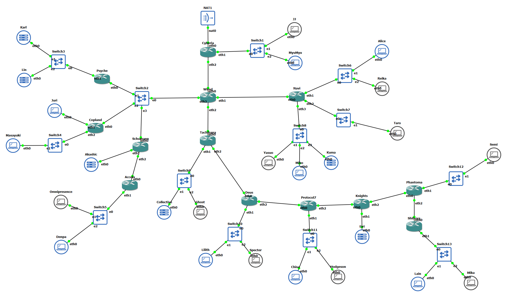
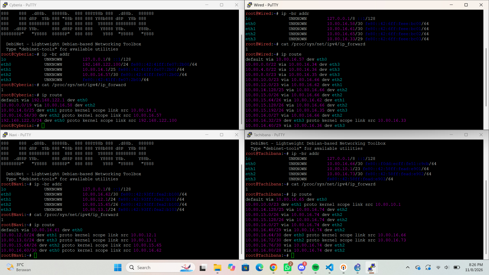
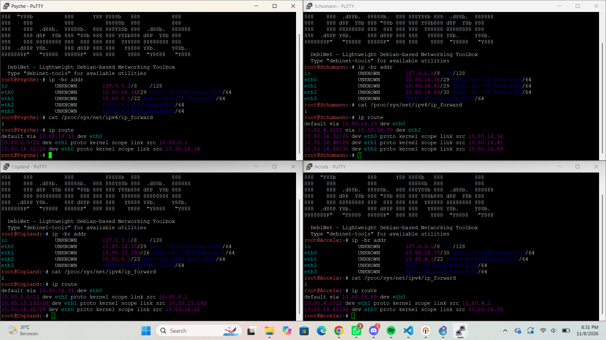
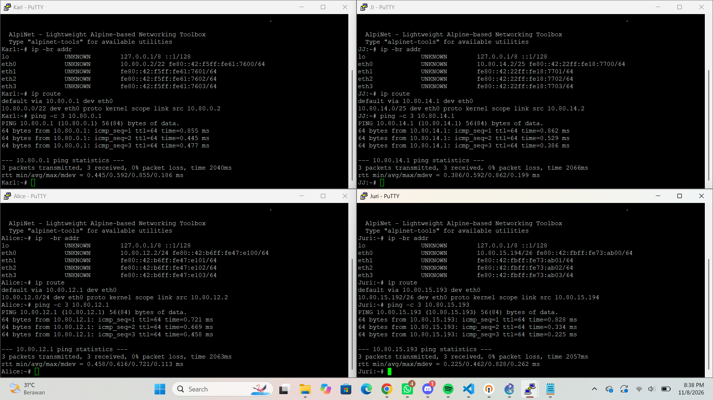
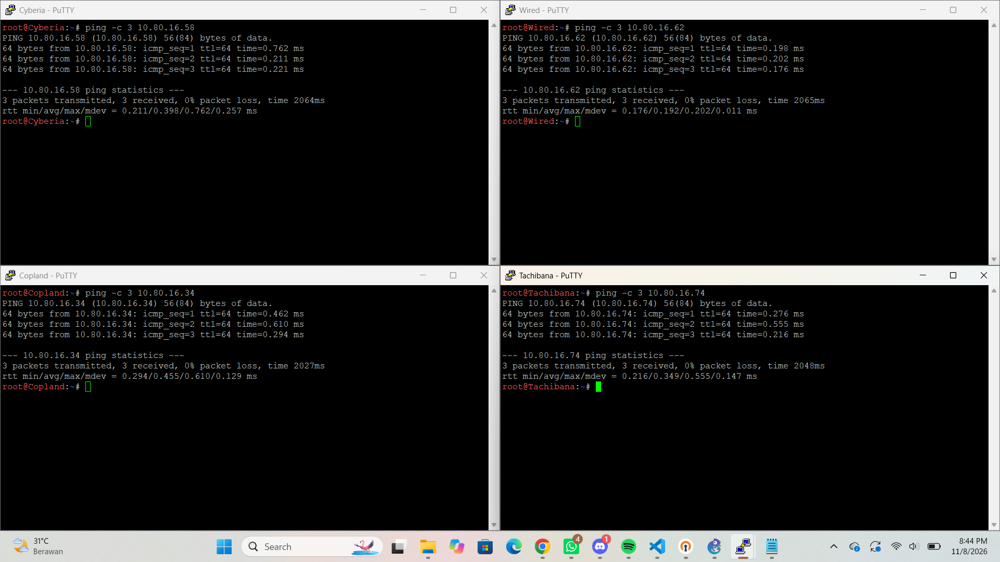
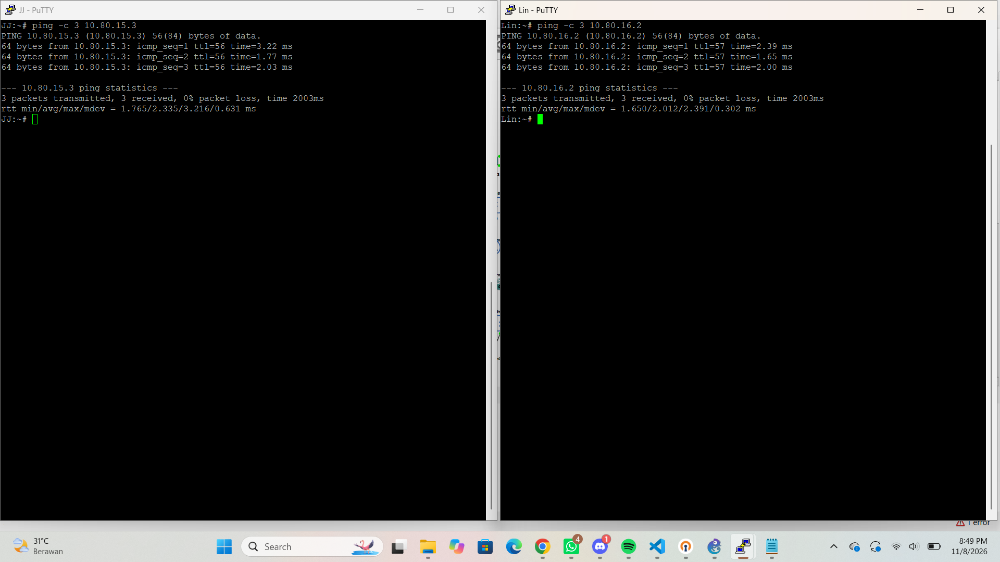
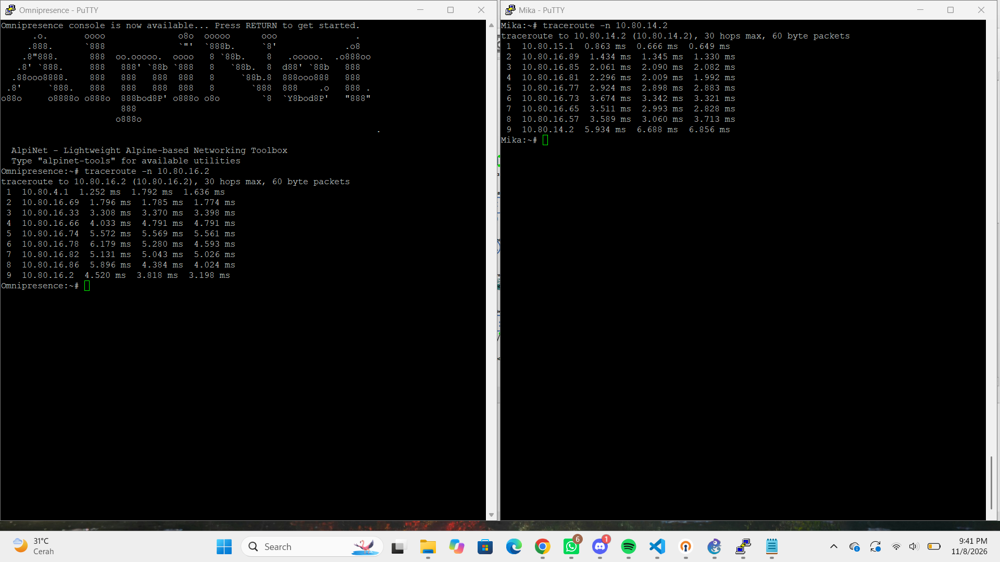
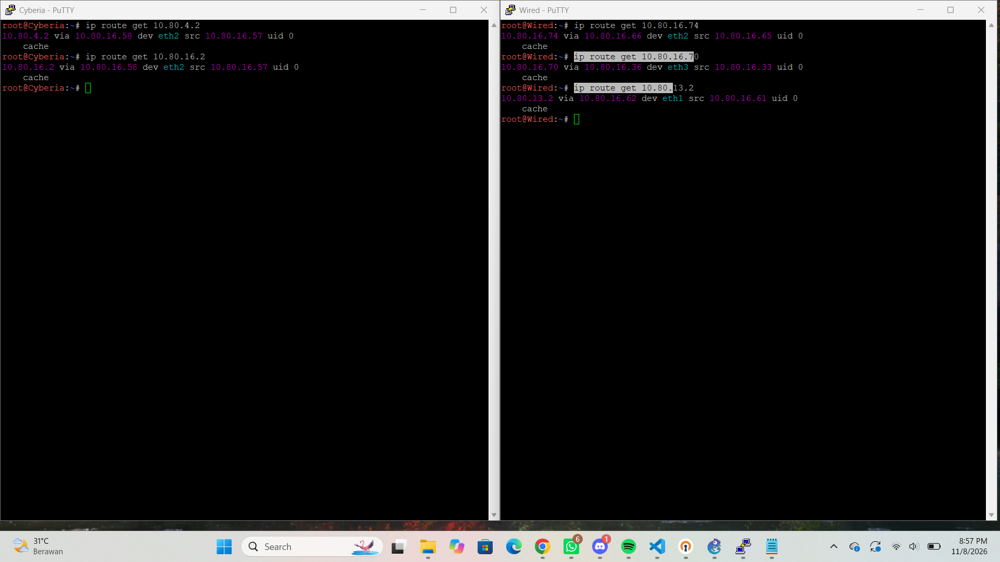
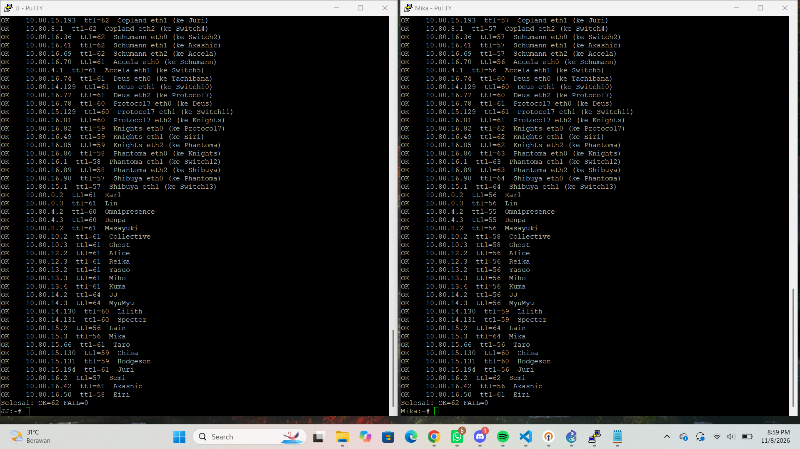
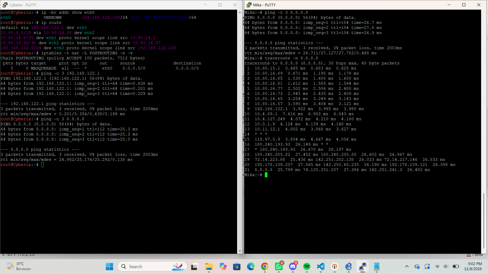

# JARKOM MODUL 3 | K-33 (DHCP)

## Anggota

| Nama | NRP |
| :--- | :--- |
| Jonathan Steven Tjahjaputra | 5027251036 |
| Helen Audya Yuniarini | 5027251069 |
---

## Rute

| Nama Subnet | Rute | Jumlah IP | Netmask |
|---|---|---|---|
| A1 | Cyberia > Switch1 > JJ, MyuMyu | 126 | /25 |
| A2 | Cyberia > Wired | 2 | /30 |
| A3 | Wired > Navi | 2 | /30 |
| A4 | Navi > Switch6 > Alice, Reika | 254 | /24 |
| A5 | Navi > Switch7 > Taro | 58 | /26 |
| A6 | Navi > Switch8 > Yasuo, Miho, Kuma | 143 | /24 |
| A7 | Wired > Tachibana | 2 | /30 |
| A8 | Tachibana > Switch9 > Collective, Ghost | 267 | /23 |
| A9 | Tachibana > Deus | 2 | /30 |
| A10 | Deus > Switch10 > Lilith, Specter | 99 | /25 |
| A11 | Deus > Protocol7 | 2 | /30 |
| A12 | Protocol7 > Switch11 > Chisa, Hodgeson | 33 | /26 |
| A13 | Protocol7 > Knights | 2 | /30 |
| A14 | Knights > Eiri | 3 | /29 |
| A15 | Knights > Phantoma | 2 | /30 |
| A16 | Phantoma > Switch12 > Semi | 15 | /27 |
| A17 | Phantoma > Shibuya | 2 | /30 |
| A18 | Shibuya > Switch13 > Lain, Mika | 62 | /26 |
| A19 | Wired > Switch2 > Psyche, Copland, Schumann | 4 | /29 |
| A20 | Psyche > Switch3 > Karl, Lin | 881 | /22 |
| A21 | Copland > Juri | 32 | /26 |
| A22 | Copland > Switch4 > Masayuki | 301 | /23 |
| A23 | Schumann > Akashic | 4 | /29 |
| A24 | Schumann > Accela | 2 | /30 |
| A25 | Accela > Switch5 > Omnipresence, Denpa | 514 | /22 |
| **Total** |  | **2814** | **/19** |

## VLSM
### Pembagian IP - VLSM

| Subnet | Network ID | Netmask | Broadcast | Range IP | Ukuran Blok | Offset | Prefix |
|---|---|---|---|---|---|---|---|
| A20 | `10.80.0.0` | `255.255.252.0` | `10.80.3.255` | `10.80.0.1 - 10.80.3.254` | 1024 | 0 | /22 |
| A25 | `10.80.4.0` | `255.255.252.0` | `10.80.7.255` | `10.80.4.1 - 10.80.7.254` | 1024 | 1024 | /22 |
| A22 | `10.80.8.0` | `255.255.254.0` | `10.80.9.255` | `10.80.8.1 - 10.80.9.254` | 512 | 2048 | /23 |
| A8 | `10.80.10.0` | `255.255.254.0` | `10.80.11.255` | `10.80.10.1 - 10.80.11.254` | 512 | 2560 | /23 |
| A4 | `10.80.12.0` | `255.255.255.0` | `10.80.12.255` | `10.80.12.1 - 10.80.12.254` | 256 | 3072 | /24 |
| A6 | `10.80.13.0` | `255.255.255.0` | `10.80.13.255` | `10.80.13.1 - 10.80.13.254` | 256 | 3328 | /24 |
| A1 | `10.80.14.0` | `255.255.255.128` | `10.80.14.127` | `10.80.14.1 - 10.80.14.126` | 128 | 3584 | /25 |
| A10 | `10.80.14.128` | `255.255.255.128` | `10.80.14.255` | `10.80.14.129 - 10.80.14.254` | 128 | 3712 | /25 |
| A18 | `10.80.15.0` | `255.255.255.192` | `10.80.15.63` | `10.80.15.1 - 10.80.15.62` | 64 | 3840 | /26 |
| A5 | `10.80.15.64` | `255.255.255.192` | `10.80.15.127` | `10.80.15.65 - 10.80.15.126` | 64 | 3904 | /26 |
| A12 | `10.80.15.128` | `255.255.255.192` | `10.80.15.191` | `10.80.15.129 - 10.80.15.190` | 64 | 3968 | /26 |
| A21 | `10.80.15.192` | `255.255.255.192` | `10.80.15.255` | `10.80.15.193 - 10.80.15.254` | 64 | 4032 | /26 |
| A16 | `10.80.16.0` | `255.255.255.224` | `10.80.16.31` | `10.80.16.1 - 10.80.16.30` | 32 | 4096 | /27 |
| A19 | `10.80.16.32` | `255.255.255.248` | `10.80.16.39` | `10.80.16.33 - 10.80.16.38` | 8 | 4128 | /29 |
| A23 | `10.80.16.40` | `255.255.255.248` | `10.80.16.47` | `10.80.16.41 - 10.80.16.46` | 8 | 4136 | /29 |
| A14 | `10.80.16.48` | `255.255.255.248` | `10.80.16.55` | `10.80.16.49 - 10.80.16.54` | 8 | 4144 | /29 |
| A2 | `10.80.16.56` | `255.255.255.252` | `10.80.16.59` | `10.80.16.57 - 10.80.16.58` | 4 | 4152 | /30 |
| A3 | `10.80.16.60` | `255.255.255.252` | `10.80.16.63` | `10.80.16.61 - 10.80.16.62` | 4 | 4156 | /30 |
| A7 | `10.80.16.64` | `255.255.255.252` | `10.80.16.67` | `10.80.16.65 - 10.80.16.66` | 4 | 4160 | /30 |
| A24 | `10.80.16.68` | `255.255.255.252` | `10.80.16.71` | `10.80.16.69 - 10.80.16.70` | 4 | 4164 | /30 |
| A9 | `10.80.16.72` | `255.255.255.252` | `10.80.16.75` | `10.80.16.73 - 10.80.16.74` | 4 | 4168 | /30 |
| A11 | `10.80.16.76` | `255.255.255.252` | `10.80.16.79` | `10.80.16.77 - 10.80.16.78` | 4 | 4172 | /30 |
| A13 | `10.80.16.80` | `255.255.255.252` | `10.80.16.83` | `10.80.16.81 - 10.80.16.82` | 4 | 4176 | /30 |
| A15 | `10.80.16.84` | `255.255.255.252` | `10.80.16.87` | `10.80.16.85 - 10.80.16.86` | 4 | 4180 | /30 |
| A17 | `10.80.16.88` | `255.255.255.252` | `10.80.16.91` | `10.80.16.89 - 10.80.16.90` | 4 | 4184 | /30 |

### Topologi VLSM - GNS3


### Pengujian - VLSM
### 3.1 Interface, IP, dan route router (13 router)

Membuktikan hasil perhitungan VLSM terpasang benar di tiap interface router, forwarding aktif, dan route sesuai rencana.

**Di node:** masing-masing router di tabel.

```bash
ip -br addr
cat /proc/sys/net/ipv4/ip_forward
ip route
```

| Router | IP yang harus muncul | ip_forward | Route buatan |
|---|---|---|---|
| Cyberia | `eth1` 10.80.14.1/25, `eth2` 10.80.16.57/30 ; `eth0` 192.168.122.100/24 | 1 | default via 192.168.122.1, 1 route spesifik |
| Wired | `eth0` 10.80.16.58/30, `eth1` 10.80.16.61/30, `eth2` 10.80.16.65/30, `eth3` 10.80.16.33/29 | 1 | default via 10.80.16.57, 15 route spesifik |
| Navi | `eth0` 10.80.16.62/30, `eth1` 10.80.12.1/24, `eth2` 10.80.15.65/26, `eth3` 10.80.13.1/24 | 1 | default via 10.80.16.61, 0 route spesifik |
| Tachibana | `eth0` 10.80.16.66/30, `eth1` 10.80.10.1/23, `eth2` 10.80.16.73/30 | 1 | default via 10.80.16.65, 7 route spesifik |
| Psyche | `eth0` 10.80.16.34/29, `eth1` 10.80.0.1/22 | 1 | default via 10.80.16.33, 0 route spesifik |
| Copland | `eth0` 10.80.16.35/29, `eth1` 10.80.15.193/26, `eth2` 10.80.8.1/23 | 1 | default via 10.80.16.33, 0 route spesifik |
| Schumann | `eth0` 10.80.16.36/29, `eth1` 10.80.16.41/29, `eth2` 10.80.16.69/30 | 1 | default via 10.80.16.33, 1 route spesifik |
| Accela | `eth0` 10.80.16.70/30, `eth1` 10.80.4.1/22 | 1 | default via 10.80.16.69, 0 route spesifik |

**Hasil:**



### 3.2 Host: IP dan gateway (25 host)

Memastikan tiap host berada di subnet yang benar dan dapat menjangkau gateway-nya.

**Di node:** masing-masing host. 
```
ip -br addr
ip route
ping -c 3 <gateway>
```

| Jalankan di | IP node ini | Perintah | Gateway milik | Diharapkan |
|---|---|---|---|---|
| Karl | `10.80.0.2/22` | `ping -c 3 10.80.0.1` | Psyche eth1 | ttl=64 |
| Alice | `10.80.12.2/24` | `ping -c 3 10.80.12.1` | Navi eth1 | ttl=64 |
| JJ | `10.80.14.2/25` | `ping -c 3 10.80.14.1` | Cyberia eth1 | ttl=64 |
| Juri | `10.80.15.194/26` | `ping -c 3 10.80.15.193` | Copland eth1 | ttl=64 |

**Hasil:**



### 3.3 Ping antar router bertetangga

Memastikan kabel dan IP tiap link router benar.

```
ping -c 3 <IP tujuan>
```
 **Diharapkan:** `0% packet loss` dan `ttl=64`.

| Jalankan di | Perintah | IP tujuan milik | Subnet | Diharapkan |
|---|---|---|---|---|
| Cyberia | `ping -c 3 10.80.16.58` | Wired eth0 | A2 | ttl=64 |
| Wired | `ping -c 3 10.80.16.62` | Navi eth0 | A3 | ttl=64 |
| Tachibana | `ping -c 3 10.80.16.74` | Deus eth0 | A9 | ttl=64 |
| Copland | `ping -c 3 10.80.16.34` | Psyche eth0 | A19 | ttl=64 |

**Hasil:**


### 3.4 Ping node ke node (ujung ke ujung)

Membuktikan setiap node dapat menjangkau node lain, termasuk route pergi dan balik, dengan pasangan dari cabang yang berbeda. Ke-38 node terlibat, baik sebagai asal, tujuan, maupun router yang dilewati.

```
ping -c 3 <IP tujuan>
```
**Diharapkan:** `0% packet loss` dan `ttl` sesuai tabel.

| Dari | IP asal | Ke | Perintah | Router yang dilewati | Diharapkan (ttl) |
|---|---|---|---|---|---|
| JJ | `10.80.14.2` | Mika | `ping -c 3 10.80.15.3` | Cyberia > Wired > Tachibana > Deus > Protocol7 > Knights > Phantoma > Shibuya | 56 |
| Lin | `10.80.0.3` | Semi | `ping -c 3 10.80.16.2` | Psyche > Wired > Tachibana > Deus > Protocol7 > Knights > Phantoma | 57 |

**Hasil:**


### 3.5 Jalur paket (traceroute)

Membuktikan paket melewati router yang benar dan tidak berputar.

```
traceroute -n <IP tujuan>
``` 
**Diharapkan:** urutan hop berikut.

**Mika ke JJ** (jalankan di Mika: `traceroute -n 10.80.14.2`):

| Hop | IP | Milik |
|---|---|---|
| 1 | `10.80.15.1` | Shibuya eth1 |
| 2 | `10.80.16.89` | Phantoma eth2 |
| 3 | `10.80.16.85` | Knights eth2 |
| 4 | `10.80.16.81` | Protocol7 eth2 |
| 5 | `10.80.16.77` | Deus eth2 |
| 6 | `10.80.16.73` | Tachibana eth2 |
| 7 | `10.80.16.65` | Wired eth2 |
| 8 | `10.80.16.57` | Cyberia eth2 |
| 9 | `10.80.14.2` | JJ (tujuan) |

**Omnipresence ke Semi** (jalankan di Omnipresence: `traceroute -n 10.80.16.2`):

| Hop | IP | Milik |
|---|---|---|
| 1 | `10.80.4.1` | Accela eth1 |
| 2 | `10.80.16.69` | Schumann eth2 |
| 3 | `10.80.16.33` | Wired eth3 |
| 4 | `10.80.16.66` | Tachibana eth0 |
| 5 | `10.80.16.74` | Deus eth0 |
| 6 | `10.80.16.78` | Protocol7 eth0 |
| 7 | `10.80.16.82` | Knights eth0 |
| 8 | `10.80.16.86` | Phantoma eth0 |
| 9 | `10.80.16.2` | Semi (tujuan) |

**Hasil:**


### 3.6 Pemilihan route (route ringkasan dan prefix terpanjang)

Membuktikan route ringkasan dan route spesifik dipakai sesuai rencana (router memilih prefix terpanjang).

```
ip route get <IP>
```


| Jalankan di | Perintah | Diharapkan | Yang dibuktikan |
|---|---|---|---|
| Cyberia | `ip route get 10.80.4.2` (Omnipresence) | `10.80.4.2 via 10.80.16.58 dev eth2 src 10.80.16.57` | route ringkasan `10.80.0.0/19` ke Wired |
| Cyberia | `ip route get 10.80.16.2` (Semi) | `10.80.16.2 via 10.80.16.58 dev eth2 src 10.80.16.57` | route ringkasan `10.80.0.0/19` ke Wired |
| Wired | `ip route get 10.80.16.74` (Deus eth0) | `10.80.16.74 via 10.80.16.66 dev eth2 src 10.80.16.65` | `10.80.16.64/27` (A9 sampai A17) ke Tachibana |
| Wired | `ip route get 10.80.16.70` (Accela eth0) | `10.80.16.70 via 10.80.16.36 dev eth3 src 10.80.16.33` | `10.80.16.68/30` ke Schumann menang atas `/27` |
| Wired | `ip route get 10.80.13.2` (Yasuo) | `10.80.13.2 via 10.80.16.62 dev eth1 src 10.80.16.61` | `10.80.12.0/23` ke Navi |

**Hasil:**


### 3.7 Semua node saling ping (`pingall.sh`)

Membuktikan tidak ada node yang terisolasi. Skrip mem-ping **semua 62 IP** (setiap interface router dan setiap host) dan menampilkan pemilik tiap IP serta ttl-nya.

**Di node:** JJ, Mika, dan Karl (tiga sudut topologi). **Diharapkan:** 62 baris `OK` dan `Selesai: OK=62 FAIL=0`.

<details>
<summary>pingall.sh</summary>

```bash
cat << 'EOF' > /root/pingall.sh
#!/bin/bash
# Ping semua 62 IP. Format: OK/FAIL  IP  ttl  pemilik
ok=0; fail=0
check() {
  out=$(ping -c 1 -W 2 "$1" 2>/dev/null)
  if [ $? -eq 0 ]; then
    t=$(echo "$out" | grep -o "ttl=[0-9]*" | head -1)
    echo "OK    $1  $t  $2"; ok=$((ok+1))
  else echo "FAIL  $1  -  $2"; fail=$((fail+1)); fi
}
check 10.80.14.1 "Cyberia eth1 (ke Switch1)"
check 10.80.16.57 "Cyberia eth2 (ke Wired)"
check 10.80.16.58 "Wired eth0 (ke Cyberia)"
check 10.80.16.61 "Wired eth1 (ke Navi)"
check 10.80.16.65 "Wired eth2 (ke Tachibana)"
check 10.80.16.33 "Wired eth3 (ke Switch2)"
check 10.80.16.62 "Navi eth0 (ke Wired)"
check 10.80.12.1 "Navi eth1 (ke Switch6)"
check 10.80.15.65 "Navi eth2 (ke Switch7)"
check 10.80.13.1 "Navi eth3 (ke Switch8)"
check 10.80.16.66 "Tachibana eth0 (ke Wired)"
check 10.80.10.1 "Tachibana eth1 (ke Switch9)"
check 10.80.16.73 "Tachibana eth2 (ke Deus)"
check 10.80.16.34 "Psyche eth0 (ke Switch2)"
check 10.80.0.1 "Psyche eth1 (ke Switch3)"
check 10.80.16.35 "Copland eth0 (ke Switch2)"
check 10.80.15.193 "Copland eth1 (ke Juri)"
check 10.80.8.1 "Copland eth2 (ke Switch4)"
check 10.80.16.36 "Schumann eth0 (ke Switch2)"
check 10.80.16.41 "Schumann eth1 (ke Akashic)"
check 10.80.16.69 "Schumann eth2 (ke Accela)"
check 10.80.16.70 "Accela eth0 (ke Schumann)"
check 10.80.4.1 "Accela eth1 (ke Switch5)"
check 10.80.16.74 "Deus eth0 (ke Tachibana)"
check 10.80.14.129 "Deus eth1 (ke Switch10)"
check 10.80.16.77 "Deus eth2 (ke Protocol7)"
check 10.80.16.78 "Protocol7 eth0 (ke Deus)"
check 10.80.15.129 "Protocol7 eth1 (ke Switch11)"
check 10.80.16.81 "Protocol7 eth2 (ke Knights)"
check 10.80.16.82 "Knights eth0 (ke Protocol7)"
check 10.80.16.49 "Knights eth1 (ke Eiri)"
check 10.80.16.85 "Knights eth2 (ke Phantoma)"
check 10.80.16.86 "Phantoma eth0 (ke Knights)"
check 10.80.16.1 "Phantoma eth1 (ke Switch12)"
check 10.80.16.89 "Phantoma eth2 (ke Shibuya)"
check 10.80.16.90 "Shibuya eth0 (ke Phantoma)"
check 10.80.15.1 "Shibuya eth1 (ke Switch13)"
check 10.80.0.2 "Karl"
check 10.80.0.3 "Lin"
check 10.80.4.2 "Omnipresence"
check 10.80.4.3 "Denpa"
check 10.80.8.2 "Masayuki"
check 10.80.10.2 "Collective"
check 10.80.10.3 "Ghost"
check 10.80.12.2 "Alice"
check 10.80.12.3 "Reika"
check 10.80.13.2 "Yasuo"
check 10.80.13.3 "Miho"
check 10.80.13.4 "Kuma"
check 10.80.14.2 "JJ"
check 10.80.14.3 "MyuMyu"
check 10.80.14.130 "Lilith"
check 10.80.14.131 "Specter"
check 10.80.15.2 "Lain"
check 10.80.15.3 "Mika"
check 10.80.15.66 "Taro"
check 10.80.15.130 "Chisa"
check 10.80.15.131 "Hodgeson"
check 10.80.15.194 "Juri"
check 10.80.16.2 "Semi"
check 10.80.16.42 "Akashic"
check 10.80.16.50 "Eiri"
echo "Selesai: OK=$ok FAIL=$fail"
EOF
chmod +x /root/pingall.sh && /root/pingall.sh
```

</details>

**Hasil:**


### 3.8 Akses internet lewat Cyberia (NAT)

Membuktikan hanya Cyberia yang terhubung ke NAT, dan node lain keluar lewat Cyberia.

**Di Cyberia:**

```bash
ip -br addr show eth0
ip route
iptables -t nat -L POSTROUTING -n -v
ping -c 3 192.168.122.1
ping -c 3 8.8.8.8
```

`eth0` = `192.168.122.100/24`; ada `default via 192.168.122.1` dan `10.80.0.0/19 via 10.80.16.58`; satu baris `MASQUERADE`; kedua ping `0% packet loss`.

**Di node lain** (contoh: Denpa, Mika, Eiri): `ping -c 3 8.8.8.8` dan `traceroute -n 8.8.8.8`.

| Node | Hop sebelum internet |
|---|---|
| Mika | `10.80.15.1` (Shibuya eth1) > `10.80.16.89` (Phantoma eth2) > `10.80.16.85` (Knights eth2) > `10.80.16.81` (Protocol7 eth2) > `10.80.16.77` (Deus eth2) > `10.80.16.73` (Tachibana eth2) > `10.80.16.65` (Wired eth2) > `10.80.16.57` (Cyberia eth2) > `192.168.122.1` (NAT1) |

**Hasil:**



